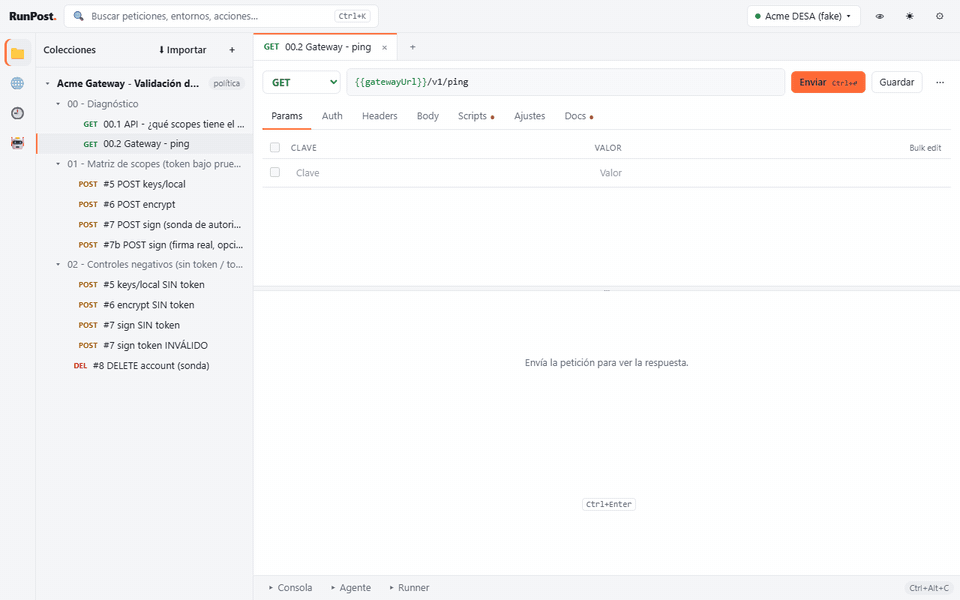

<p align="right"><b>English</b> · <a href="README.es.md">Español</a></p>

<p align="center"></p>

<h1 align="center">RunPost</h1>

<p align="center"><b>One binary. No account. No telemetry.</b><br>
The HTTP client you and your AI agent share: a Postman-like desktop app with a built-in MCP server.</p>

<p align="center">
  <a href="https://github.com/paul0610/runpost/actions/workflows/ci.yml"></a>
  <a href="https://github.com/paul0610/runpost/releases"></a>
  <a href="LICENSING.md"></a>
  <a href="docs/MCP.md"></a>
  
</p>

<p align="center">
  <a href="https://paul0610.github.io/runpost/">Website</a> ·
  <a href="https://github.com/paul0610/runpost/releases/latest">Download</a> ·
  <a href="docs/MCP.md">MCP tools</a> ·
  <a href="CONTRIBUTING.md">Contributing</a>
</p>



RunPost is a local HTTP client for people who live in Postman-style collections **and** work with
AI coding agents. You build and send requests in a familiar UI; your agent (Claude Code, Codex…)
runs the same saved requests through RunPost's MCP server, gets compact answers with secrets
masked, and you watch every call live — and approve the risky ones — from the **Agent** panel.

## Why RunPost

As of October 2026 ([details and sources](docs/COMPARISON.md); corrections welcome):

| | RunPost | Postman | Bruno | Insomnia | Yaak |
|---|---|---|---|---|---|
| Account to save collections | No | Yes | No | Yes for projects | No |
| Plain-text files for Git | JSON per collection | YAML (v12), tied to a cloud workspace | YAML / `.bru` | Git Sync, with account | Opt-in YAML |
| MCP server for agents | Built in (stdio + HTTP), no account | Separate (remote or npm), account | Separate, early (`bruno-mcp`) | No (MCP client only) | In-app plugin |
| Live view of the agent's calls, approvals in the app | Yes | — | — | — | — |
| Secrets in the OS keychain | Per variable | Vault key | OS encryption | Vault key | Master key |
| CLI runner with JUnit | Yes | Yes (Postman CLI, Newman) | Yes (`bru`) | No | No |
| License | AGPL-3.0, free; commercial license for closed products | Proprietary, free plan | MIT, paid tiers | Apache-2.0, free plan | MIT source, paid for work |
| Spanish UI | Yes | No | No | No | No |

"—": not found in their documentation.

## Numbers

Measured with the real release binaries; the token figures use the bundled example collection against a simulated API
(details in [docs/BENCH.md](docs/BENCH.md)):

| What | RunPost |
|---|---|
| Whole `tools/list` (13 tools, sent once per session) | ≈ 1,675 tokens |
| `run_request` "00.2 Gateway - ping" | ≈ 200 characters ≈ 50 tokens |
| `run_request` with `select` on one field | < 60 tokens |
| A typical 5 KB JSON response | < 700 tokens (minified, truncated, rest on demand) |
| Claude Code plugin always-on cost | ≈ 112 tokens (+ ≈ 630 when the skill fires) |
| Desktop app on Windows 11: size, start to usable window, memory at rest | 20.5 MB, 1.25–1.45 s, 35–37 MB (plus the system WebView) |
| CLI / MCP server: size, start to `initialize` | 17.9 MB, ≈ 75 ms |
| Full Claude Code session, curl vs RunPost | being measured: the harness is in `scripts/bench/` (see [docs/BENCH.md](docs/BENCH.md)) |

## Install

Download from [Releases](https://github.com/paul0610/runpost/releases/latest). The builds are not
code-signed yet, so the first launch asks for confirmation.

**Windows**: download `RunPost_0.2.0_x64-setup.exe` and double-click it. It installs for your user
in `%LOCALAPPDATA%\RunPost` (no admin), with `runpost_mcp.exe`, and adds RunPost to the Start menu.
`RunPost_0.2.0_x64-portable.exe` runs without installing. Or, in PowerShell:

```powershell
Invoke-WebRequest https://github.com/paul0610/runpost/releases/download/v0.2.0/RunPost_0.2.0_x64-setup.exe -OutFile RunPost-setup.exe
.\RunPost-setup.exe
[Environment]::SetEnvironmentVariable('Path', [Environment]::GetEnvironmentVariable('Path','User') + ";$env:LOCALAPPDATA\RunPost", 'User')
```

**macOS** (Apple silicon):

```bash
curl -LO https://github.com/paul0610/runpost/releases/download/v0.2.0/RunPost_0.2.0_aarch64.dmg
hdiutil attach RunPost_0.2.0_aarch64.dmg && cp -R /Volumes/RunPost/RunPost.app /Applications/ && hdiutil detach /Volumes/RunPost
xattr -dr com.apple.quarantine /Applications/RunPost.app && sudo ln -sf /Applications/RunPost.app/Contents/MacOS/runpost_mcp /usr/local/bin/runpost_mcp
```

**Linux** (Debian/Ubuntu; there is also an `.AppImage`):

```bash
curl -LO https://github.com/paul0610/runpost/releases/download/v0.2.0/RunPost_0.2.0_amd64.deb
sudo apt install ./RunPost_0.2.0_amd64.deb
runpost_app
```

The last line of each block puts `runpost_mcp` (the CLI and MCP server) on your `PATH`, which the
agent integrations below need. CLI-only archives are in the release too.

## Connect your agent

**Claude Code** — one line in your terminal (Claude Code 2.1.275 or later):

```bash
claude plugin install runpost --marketplace paul0610/runpost
```

(or inside Claude Code: `/plugin marketplace add paul0610/runpost`, then `/plugin install runpost@runpost`).
The plugin adds the RunPost MCP server, the `api-testing` skill (how to spend few tokens) and the
commands `/runpost:run`, `/runpost:suite` and `/runpost:import`. With the RunPost app open on the
same workspace, the plugin's calls go through the app: you see them in the Agent panel and protected
requests wait for your approval.

**Codex, Claude Desktop and others** — in the app, **Agent → Connect agent ▾** copies a ready-made
config with your paths. Examples: [docs/mcp-client-configs/](docs/mcp-client-configs/), including an
[`AGENTS.md`](docs/mcp-client-configs/AGENTS.md) for Codex.

## Features

- Postman-style UI: collections, folders, tabs, params/headers/body/auth editors, environments and
  globals, history, console, markdown docs, light and dark themes, Postman shortcuts. English and
  Spanish (Settings → Language).
- Import from Postman v2.1, OpenAPI 3, HAR, Insomnia (v4 and v5), Bruno (`.bru`, YAML or JSON) and
  cURL ([what is translated](docs/IMPORT.md)); export to Postman v2.1. Code snippets (cURL, fetch,
  PowerShell, Python) that keep secrets as `{{variables}}`, and GraphQL bodies
  ([details](docs/REQUESTS.md)).
- Auth: bearer, basic, API key, digest and OAuth 2.0 (client credentials, and authorization code
  with PKCE and a local callback). Tokens stay in memory or the OS keyring, never in files
  ([details](docs/AUTH.md)).
- Cookie manager and client certificates per host for mutual TLS ([details](docs/NETWORK.md)).
- Saved examples per request, find and replace across a collection (regex optional), and a trash
  with undo for 30 days ([details](docs/COLLECTIONS.md)).
- `pm.*` pre-request and test scripts (QuickJS sandbox), Collection Runner with CSV/JSON data and
  JUnit/HTML reports — also from the terminal (`runpost_mcp run`).
- MCP server (stdio, or Streamable HTTP when the app is open) with 13 compact tools: refer to saved
  requests by name, `select` (JSONPath), `get_response` by ranges, `diff_against` to see only what
  changed, `run_collection` summaries.
- Agent guardrails per collection: allowed methods, approval in the app (60 s), calls per minute.
- Secrets masked everywhere (`***` for the agent, history and logs) and optionally stored in the OS
  keyring (Windows Credential Manager, macOS Keychain, Secret Service) instead of the workspace file.
- Plain-text, Git-friendly workspace: one JSON file per collection and environment.

## Build from source

Rust (see `rust-toolchain.toml`), Node.js 22 and the [Tauri v2 prerequisites](https://v2.tauri.app/start/prerequisites/):

```bash
cd ui && npm ci --ignore-scripts && npm run build && cd ..
cargo build --release
```

Then run `target/release/runpost_app` (desktop) or `target/release/runpost_mcp serve --browser`
(the same UI at `http://127.0.0.1:7878`). Developer notes in Spanish:
[README.es.md](README.es.md#compilar-y-desarrollar).

## License

RunPost is free software under the [GNU AGPL-3.0](LICENSE). To build it into a closed-source product
or service, a commercial license is available: see [LICENSING.md](LICENSING.md). Versions 0.1.0 and
0.2.0 were released under the MIT license.

© 2026 Paul Rojas — created by [Paul Rojas](https://github.com/paul0610).
